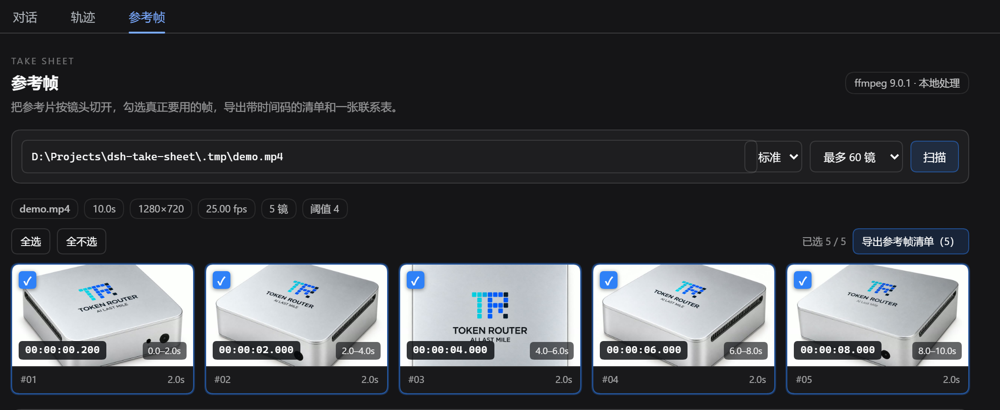
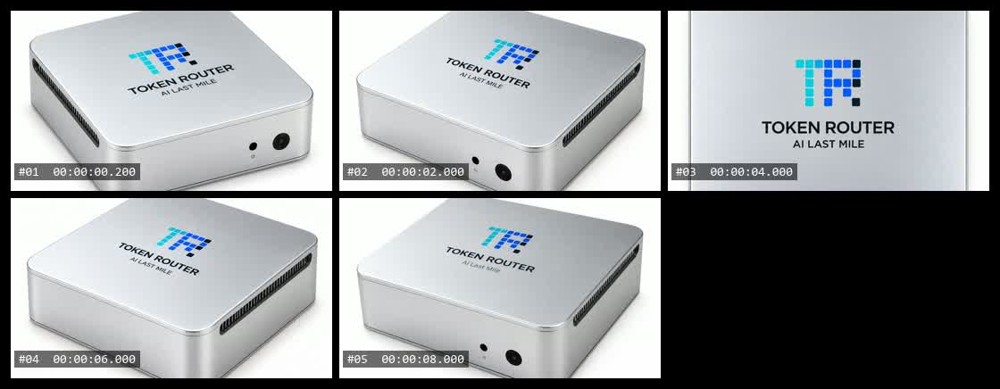
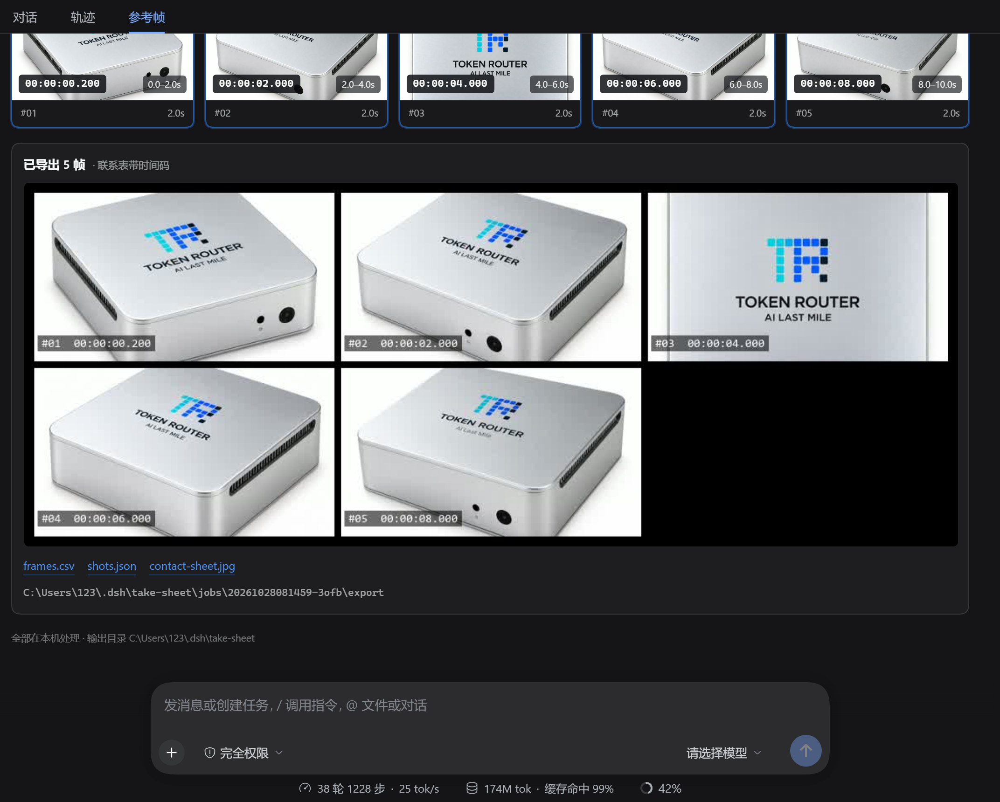

# dsh-take-sheet

把一段参考视频按镜头切开，逐镜抽一帧，人工勾选后导出**带时间码的参考帧清单**和**一张联系表**。



这是 DeepSeek Harness 的一个插件：在对话视图里多一个「参考帧」页签。视频、帧和导出物都只在本机处理，不上传。

## 为什么做这个

做视频、广告或产品动画时，真正要交给下游的不是「一段参考视频」，而是「第 2 秒这一帧、第 6 秒这一帧，按这个顺序」。现成的抽帧工具通常把帧直接喂给模型，或者按固定间隔抽一堆；人还是要自己对着播放器找镜头、记时间码、截图、拼表。

这个插件把这段手工活收成一条流程：

1. 一次解码，检测镜头切点；
2. 每个镜头给一帧缩略图，带精确到毫秒的时间码；
3. 勾掉不要的，留下要用的；
4. 导出 `frames.csv`、`shots.json`、`frames/` 和一张带时间码标签的联系表。

## 功能

- **按镜头切**：用 ffmpeg 的 `scdet` 镜头检测，而不是固定间隔。切点阈值可选「敏感 / 标准 / 稳健」。
- **人工勾选**：每镜一张 16:9 缩略图，点击卡片或复选框切换；全选 / 全不选；未选中的卡片会变暗。
- **时间码是帧自己的**：缩略图上的 `00:00:02.000` 就是导出文件名和 CSV 里的时间码，不是近似的镜头起点。
- **联系表**：自动按接近 3:2 的网格排版，黑底、每格左上角标 `#01 00:00:00.200`；字体找不到时退化为无标签版本，不会让导出失败。
- **导出即文件**：CSV / JSON / JPEG / 帧文件都可直接打开、拷进 brief 或提交到项目里。
- **不离开本机**：没有网络请求，不读 `~/.dsh` 以外的配置。

导出后的联系表：



导出结果面板（联系表预览 + 三个下载链接 + 本机输出目录）：



## 安装

需要 **ffmpeg 5.1+**（含 `ffprobe`）。插件不会替你安装它，但会自动在这些位置找：

- `DSH_FFMPEG_PATH` / `FFMPEG_PATH` 环境变量；
- Windows 的 WinGet Links 目录（`winget install Gyan.FFmpeg` 后就在那里）；
- `C:\ffmpeg\bin`、Chocolatey、`PATH`；
- macOS 的 Homebrew、Linux 的 `/usr/bin`。

安装到某个 DSH profile：

```bash
dsh plugin --profile desktop add D:\Projects\dsh-take-sheet
```

`lib/` 已随仓库提交，检出后不需要构建。装好后刷新 Web GUI，在任意会话的页签里点「参考帧」。运行中才装 ffmpeg 也不用重启：面板会提示缺少 ffmpeg，装好后点「重新检测」即可。

## 使用

1. 粘贴视频的**绝对路径**（本地文件，不支持 URL），例如 `D:\refs\clip.mp4`；
2. 选灵敏度和最多镜头数，点「扫描」；
3. 扫完会列出每个镜头的一帧；点卡片或复选框保留 / 去掉；
4. 点「导出参考帧清单」；面板下方出现联系表预览和三个下载链接。

「敏感」更容易把轻微转场也切成新镜头；「稳健」只认硬切。默认「标准」。如果一段片子里切点太多，会按时间均匀保留，并在面板上说明丢弃了多少个切点。

## 输出

每次导出写到 `$DSH_HOME/take-sheet/jobs/<job-id>/export/`：

```
export/
  frames.csv
  shots.json
  contact-sheet.jpg
  frames/
    01_00-00-00.200.jpg
    02_00-00-02.000.jpg
    ...
```

`frames.csv`（UTF-8 BOM，CRLF，Excel 直接打开）：

```csv
shot,timecode,seconds,start,end,duration,file,source
1,00:00:00.200,0.200,0.000,2.000,2.000,frames/01_00-00-00.200.jpg,"D:\refs\clip.mp4"
```

`shots.json` 额外记录源视频的 probe 信息（时长、分辨率、fps、编码）、扫描参数、每个镜头的起止时间和联系表尺寸，方便脚本消费。

文件名里的时间码用 `-` 代替 `:`，因为 Windows 文件名不允许冒号；CSV 和画面上的标签仍是标准 `HH:MM:SS.mmm`。

## 与已有方案的关系

调研时看过三个 DSH 视频相关插件：

- `Something11235/dsh-video-skin`：把视频做成壁纸 / 启动动画，不做抽帧；
- `HongtaoWang75/dsh-video-see`：调用 ffmpeg 抽帧给**模型**看，带时间戳，也有拼图模式；
- `shisuiqingqian/dsh-video-kit`：转写 + 关键帧，主要也是给 agent 做上下文。

所以「视频抽帧」这件事并不新，日报里「没人做视频理解」的说法不准确。本项目的差别只在流程的重心：**镜头切分 + 人在环勾选 + 可交付的时间码清单/联系表**，是给人做参考板用的，而不是给模型补上下文。没有复制上述任何项目的代码；抽帧命令是按 ffmpeg 文档和本机实测写的。插件的构建骨架（零依赖 `lib/`、`cordis.patch.yml`、host/client 两半、测试结构）沿用了同作者的 `dsh-warden`，业务代码是重新实现的。

一个实现上的选择：镜头检测用 `scdet` 而不是 `select='gt(scene,T)'`。在深色、低对比的产品渲染片上，`scene` 分数只有 0.24 左右，硬切也只有 ~0.26，很难分；`scdet` 在同一段素材上硬切约 9–10、普通帧约 0.005，阈值好定得多。

## 限制

- 只处理本地文件；不下载 URL、不读流媒体。
- 没有音频分析，也没有转写；镜头切分只看画面。
- 单次最多 200 个镜头（默认 60），极长视频需要多扫几段。
- 联系表的字体优先 Consolas / Segoe UI / Arial / DejaVu / Liberation；都没有时导出无标签版本。
- 导出会覆盖同一 job 的上一次导出（`export/` 会先清空）。

## 开发

```bash
node scripts/build.mjs     # src/ -> lib/，并把 CSS 内联进 client bundle
node --test test/*.test.mjs
```

测试共 39 个：纯函数（时间码、切点规划、CSV/ffmpeg 转义、网格）、media 层参数与版本门禁、host 路由与导出（假 media + 真 store）、client bundle 契约。`test/integration.test.mjs` 会用真实 ffmpeg 生成一段 6 秒三色视频，验证「两个切点 → 三个镜头 → 带标签联系表」；没有 ffmpeg 的机器上这组会自动 skip，而不是假装通过。

`lib/` 是提交进仓库的构建产物。改了 `src/` 必须重新 `node scripts/build.mjs` 并一起提交，CI 会检查 `lib/` 与 `src/` 是否一致。

## License

MIT
